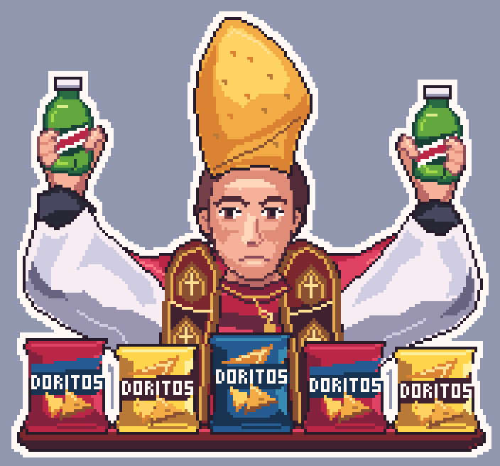
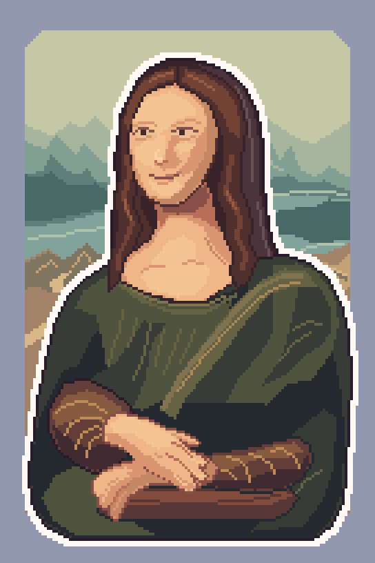
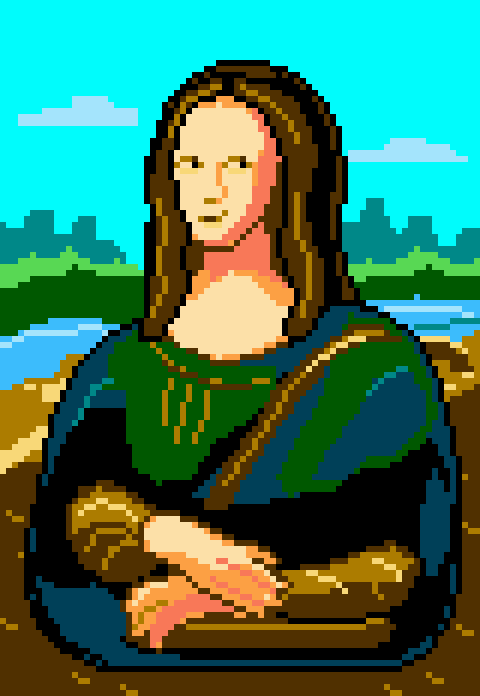
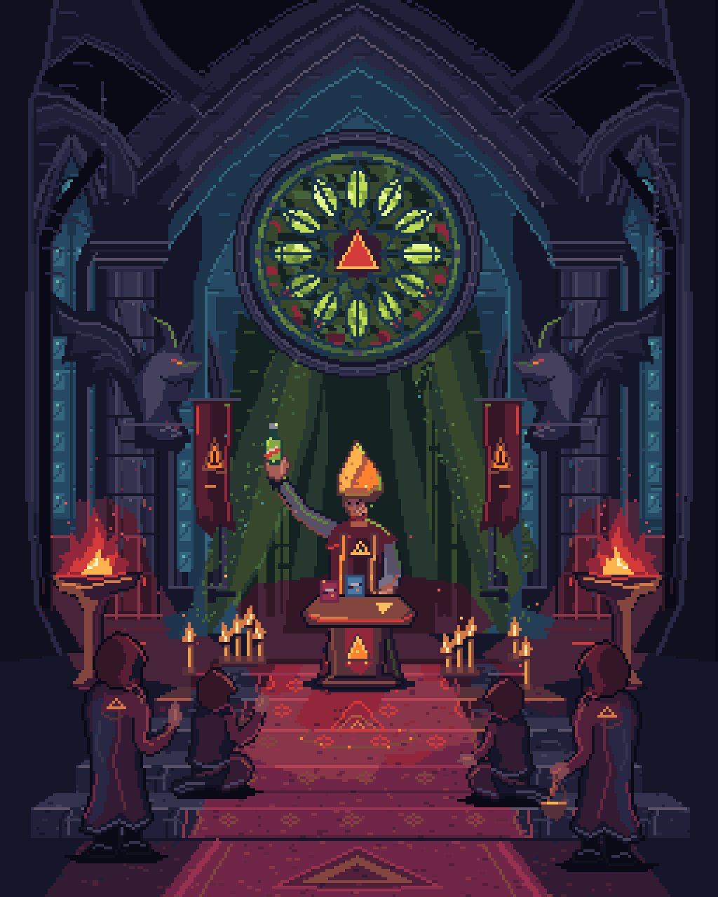
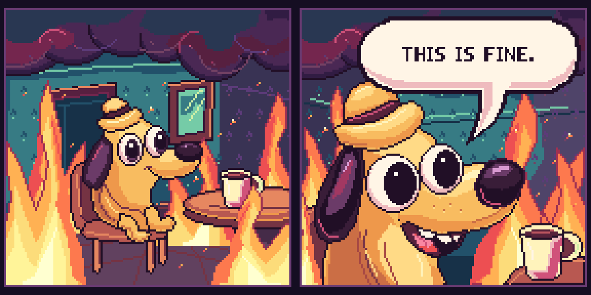

# Image Model Shmimage Model

Use the `shmimage` skill with any coding agent that can read project files and run local commands. Turn a photo into a palette-limited sprite, hand-redraw a subject in a style you provide, or create a seamless pixel-art texture. The timelapse shows how the image developed from silhouette to finished pixels.

## Start with the skill

1. Open this project as your agent’s working directory. Attach any references or give the agent their file paths. For an original tile, a written brief is enough.
2. Invoke `$shmimage` if your agent has it available as a skill, or ask the agent to read and follow [SKILL.md](SKILL.md). Say whether you want a conversion that preserves the composition or a hand redraw in a different style. If you provide a style reference, identify which image gives the subject and which gives the style.
3. Review the result and give the agent feedback. Ask it to reuse the same case for follow-up edits so the timelapse shows each saved revision in order.

> Read and follow `SKILL.md`. Hand-redraw the first image using the second as a style reference. Keep the pose and expression, and deliver a native PNG, a 4× preview, and a timelapse.

## Examples

| Doritos Pope sticker | Mona Lisa sticker | Mona Lisa in an NES palette |
| --- | --- | --- |
|  |  |  |
| [Native PNG](examples/doritoPopeGeoff_original.png) · [Timelapse](examples/doritoPopeGeoff_timelapse.gif) | [Native PNG](examples/monaLisaV1_originalSize.png) · [Timelapse](examples/monaLisaV1_timelapse.gif) | [Native PNG](examples/monaLisaV2_originalSize.png) · [Timelapse](examples/monaLisaV2_timelapse.gif) |

### Doritos Pope Cathedral



[Native artwork](examples/doritoPopeCathedral-original.gif) · [4× preview](examples/doritoPopeCathedral-4x.gif) · [Timelapse with revisions](examples/doritoPopeCathedral-timelapse.gif)

### This Is Fine



[Native PNG](examples/thisIsFine_originalSize.png) · [Timelapse with revisions](examples/thisIsFine_timelapse.gif)

## What you get

Each case keeps the four build passes and any supplied subject reference under `cases/<name>/`. Open `deliver/` for the native PNG, enlarged PNG, color palette, and build timelapse. The timelapse includes a chapter with labeled before-and-after views when the case has saved revisions. [See export options and revision history](references/aseprite-and-delivery.md).

## Optional command-line workflow

From the project folder, set up Python 3.10 or later with NumPy and Pillow.

```bash
python3 -m venv .venv
.venv/bin/python -m pip install numpy Pillow
```

Replace `/path/to/photo.jpg` with your source image. The example keeps the full scene and uses 24 colors on a grid up to 112 pixels wide or tall.

```bash
.venv/bin/python scripts/shmimage.py init cases/my-art --input /path/to/photo.jpg --size 112 --palette auto --colors 24
.venv/bin/python scripts/shmimage.py prep cases/my-art --bg-mode none
.venv/bin/python scripts/shmimage.py fit cases/my-art --dither none
.venv/bin/python scripts/shmimage.py check cases/my-art
.venv/bin/python scripts/shmimage.py deliver cases/my-art --scale 4
```

Use `--bg-mode auto` to isolate a subject. Built-in palettes include Game Boy (`gameboy`), PICO-8 (`pico8`), Sweetie 16 (`sweetie16`), NES (`nes`), and Endesga 32 (`endesga32`). Open the saved passes and compare the face, pose, or other focal details against the source before exporting.

The CLI can also package artwork drawn directly on a small pixel grid with `deliver --manual`. [See the hand-redraw walkthrough](references/hand-redraws.md).

Use `init --tile` for an original or referenced seamless texture. Use `tile-preview` to inspect a repeated field or bring the tile joins to the center, and `tile-stats` to check luminance balance, palette coverage, and seam continuity. [See seamless tile creation and styling](references/seamless-tiles.md).

Use `extract` to create candidate line art and a protected detail mask. Open the generated local review page to edit them with a keep/erase brush. The `style` command samples a palette and outline settings from a style image, and `fit` can apply both the edited masks and the sampled style. [See the guided conversion workflow](references/guided-conversion.md).

## License

Project code and documentation are available under the [MIT License](LICENSE). Third-party artwork and reference images remain subject to their respective rights.
